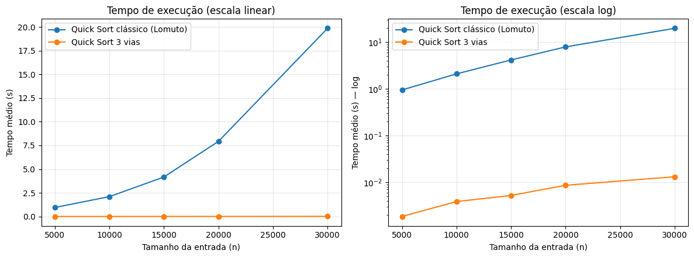

# Quick Sort — Grupo 4
**Fatec Ourinhos · Ciência de Dados · Algoritmos de Ordenação e Busca**
Profa. Jéssica Delgado · 2026

Integrantes: Vitor Augusto Neias, Gabriel Gulia, Marco Albano e João Miguel.

Implementação do Quick Sort (versão clássica com partição de Lomuto e variante
com partição em 3 vias) e medição de desempenho na ordenação da coluna
"número de veículos envolvidos" do dataset Datatran 2024.

## Arquivos
- `grupo4_quicksort.ipynb`: código, testes, medições e análise
- `grafico_quicksort.png`: gráfico tamanho da entrada (n) × tempo de execução

## Como executar
1. Baixe o `datatran2024.csv` em
   https://github.com/AndersonSalata/projeto-integrado-ciencia-de-dados
2. Abra o `grupo4_quicksort.ipynb` no Google Colab
3. Envie o CSV para a pasta `/content/` (ícone de pasta na barra lateral)
4. Use *Ambiente de execução → Executar tudo*

A medição completa leva cerca de 5 minutos.

## Resultado principal
Com muitos valores repetidos (só 19 valores distintos), a versão clássica caiu no
pior caso O(n²), enquanto a versão 3 vias cresceu de forma quase linear:
em 30.000 registros, ela foi ≈ 1.514 vezes mais rápida.

